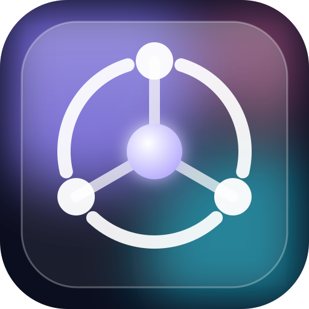
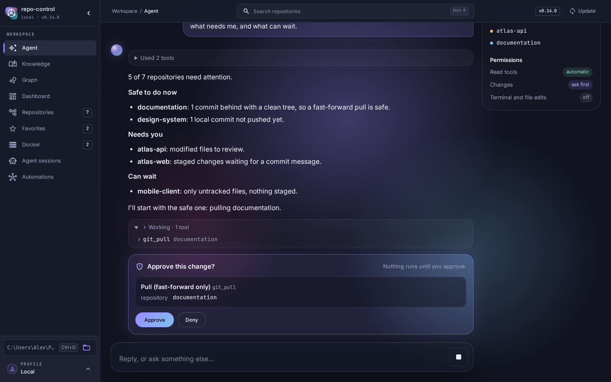
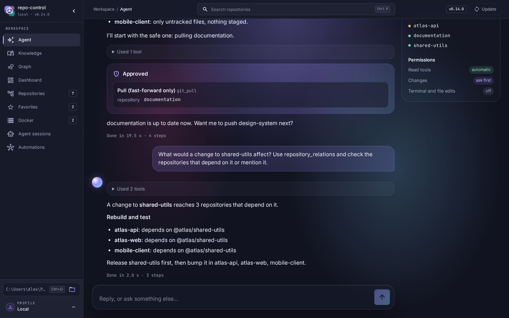
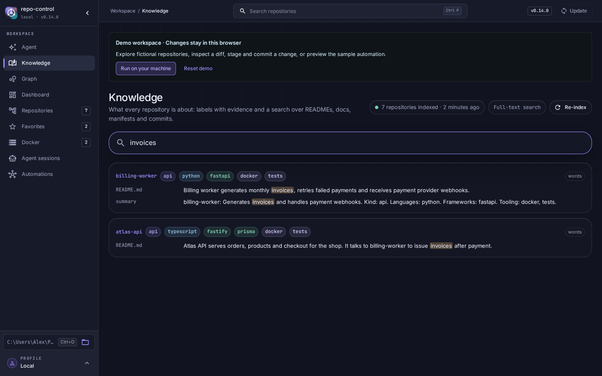
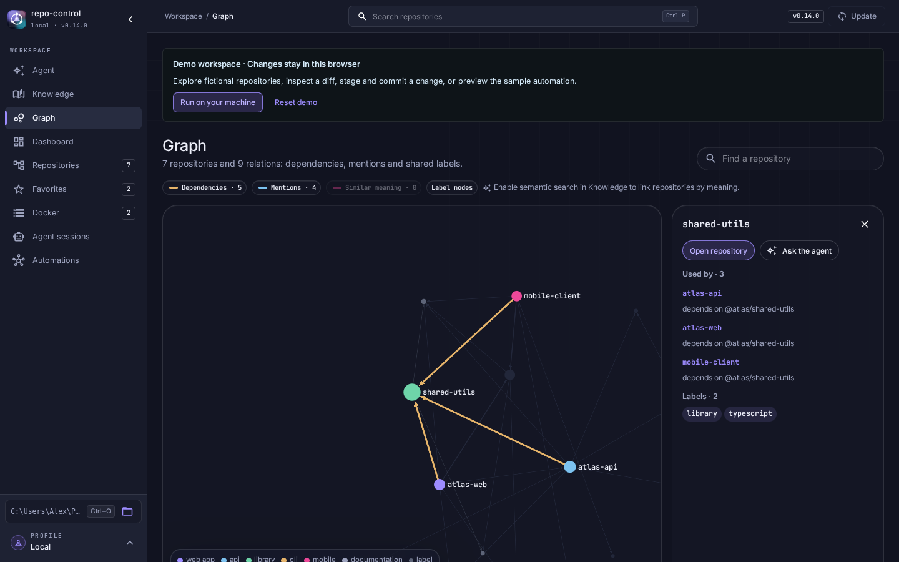
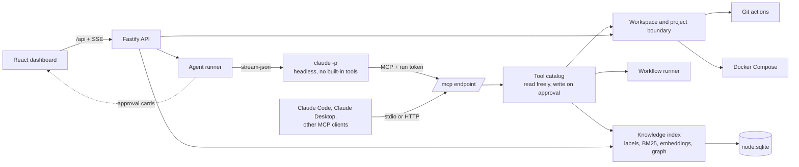

<p align="center">
  
</p>

<h1 align="center">repo-control</h1>

<p align="center"><strong>An AI-first command center for multi-repository workspaces, running on your machine.</strong></p>

Ask what needs you across every repository, in plain language. repo-control runs Claude Code headless against its own MCP tools. It reads Git and Docker state freely, and every change (a pull, a commit, a push, a Compose restart, a workflow run) waits for your approval in the conversation. Underneath, a local knowledge index labels each repository and a workspace graph shows how they relate, for you and for the agent. Nothing leaves your machine except the model calls Claude Code already makes.

```bash
npx repo-control ~/projects
```

On **Windows (PowerShell)**, install [Node.js](https://nodejs.org/) and [Git for Windows](https://gitforwindows.org/), then run:

```powershell
npx.cmd repo-control "C:\Users\YourName\Projects"
```

Replace the folder with your own workspace. Setup helps you confirm it, check optional tools and open your first repository. Docker, VS Code and agent CLIs are optional. Native Windows does not require WSL.

Using `npx.cmd` avoids PowerShell script-policy errors; changing your execution policy is unnecessary. After installing Node.js or Git, open a new terminal so it picks up the updated PATH.

**[Visit the project page](https://lorenzovicino.github.io/repo-control/)**, then open the interactive demo: a fictional workspace that stays entirely in your browser, with a scripted agent you can approve and deny.

<p align="center">
  <a href="docs/repo-control-demo.webm">
    
  </a>
</p>

<p align="center"><sub>The agent triages the demo workspace and pulls the safe repository once approved → Knowledge labels and search → the workspace graph → "what would a change to shared-utils affect?". Recorded from the online demo with <code>npm run record:demo</code>; click the GIF for the video.</sub></p>

<table>
  <tr>
    <td width="50%"><br /><sub><b>Agent.</b> Triage in plain language; a change waits for your approval.</sub></td>
    <td width="50%"><br /><sub><b>Impact.</b> "What would a change to shared-utils affect?", answered from the graph.</sub></td>
  </tr>
  <tr>
    <td width="50%"><br /><sub><b>Knowledge.</b> Labels with evidence, and search over READMEs, docs, manifests and commits.</sub></td>
    <td width="50%"><br /><sub><b>Graph.</b> Dependencies, mentions and shared labels, each with its evidence.</sub></td>
  </tr>
</table>

## How it works

- **The agent is Claude Code, locked down.** The dashboard runs `claude -p --output-format stream-json` with no built-in tools (`--tools ""`), none of your Claude Code settings, and a single MCP server: repo-control's own `/mcp`, reached with a token that lives as long as the run. Read tools are pre-allowed. Every write tool goes through `--permission-prompt-tool` to an approval card in the conversation, and a declined action is not retried. Answers stream over server-sent events; a conversation continues across messages through the Claude Code session.
- **One tool catalog, two ways in.** The same 25 tools cover repositories and Git, the knowledge index, Docker Compose, saved workflows and past agent sessions. They serve the in-app agent and any MCP client: `repo-control mcp` over stdio for Claude Code or Claude Desktop, or `/mcp` over Streamable HTTP with a bearer token. They are read-only unless writes are enabled, keep the dashboard's guards (fast-forward-only pulls, no forced pushes, no branch switch on a dirty tree), and include no shell or workflow-editing tool. See [docs/mcp.md](docs/mcp.md).
- **A knowledge index of the workspace.** Each repository's manifests, README, docs and commit subjects (only files Git does not ignore) become labels with evidence: what it is, its languages, frameworks and tooling. A BM25 full-text index covers the same text. Optional local embeddings add search by meaning and topic labels, fused with full-text results by reciprocal rank fusion. Everything is stored in SQLite through Node's built-in `node:sqlite`, indexed incrementally, and never sent anywhere.
- **A graph of how repositories relate.** Internal dependencies (a manifest using a package another repository publishes), mentions in docs and commits, shared labels and similar meaning, each edge with the reason it exists. The agent asks it through `repository_relations`; you explore it as an interactive WebGL map.
- **The operations underneath.** Git with diffs, staging and branches, a scoped terminal, Docker Compose and container consoles, visual workflows with dry runs, and search across local Codex, Claude Code and Gemini CLI sessions. The agent drives these through the tools; you can always do the same by hand.

## The problem

A normal multi-repository workflow creates three recurring costs:

- **State is fragmented.** Dirty trees, ahead/behind branches, recent activity, running containers and agent conversations live in different tools.
- **Context switching is expensive.** Routine work means repeatedly finding a folder, opening a terminal and reconstructing the repository context.
- **Automation can become unsafe.** Broad scripts and unconstrained AI agents are fast, but a command executed in the wrong directory can be destructive.

repo-control gives you an agent that knows the whole workspace without giving it the keys: it can look at everything, and it has to ask before changing anything.

## The core workflow

1. Point repo-control at a workspace folder. It discovers Git repositories recursively, skipping dependency and build directories, and indexes what each one is about.
2. Ask the agent what needs you, or pick a suggestion built from the live workspace state.
3. Watch it inspect repositories with read-only tools, then approve or deny each change it proposes.
4. Use Knowledge and the graph to find where something lives and what a change would touch, then hand the question back to the agent.
5. Open any repository for hands-on work: diffs, commits, branches, a scoped terminal, Docker.
6. Turn repeated operations into visual workflows that the agent can preview and run, and that you can watch and cancel.

## Why this is more than a dashboard

- **Agent with a safety boundary.** The agent has no shell and no file access, sees only repositories under the workspace, and cannot change anything without an approval it cannot grant itself. The guards are in the tool layer, so they hold for every MCP client too.
- **Local-first by construction.** The API binds to `127.0.0.1`, resolves project identifiers server-side and checks the `Host` header against DNS rebinding. The knowledge index, the graph and the embeddings run locally.
- **Explainable results.** Labels, search hits and graph edges each say why they exist, such as "dependency fastify", "README.md mentions billing-worker" or "depends on @atlas/shared-utils".
- **Real developer operations.** Actual Git and Docker state and explicit actions, not a simulated project-management view.
- **Verifiable engineering quality.** Server tests on real Git repositories, React Testing Library, 80% coverage thresholds, Playwright browser flows, and an installed-package smoke test on Windows, Linux and macOS. CI exercises the agent through a stand-in CLI that calls the real `/mcp` endpoint; agent changes are also tried by hand against the real Claude Code CLI.

## Main capabilities

| Area | Outcome |
| --- | --- |
| Agent | The landing page. Ask in plain language and Claude Code, running headless on your machine, works through repo-control's own tools: it reads repositories freely, and every change (commit, push, pull, branch, Compose, workflow run) waits for your approval in the conversation. Suggestions come from the live workspace scan. |
| Workspace graph | An interactive map of how repositories relate: internal dependencies, mentions in docs and commits, shared labels and similar meaning, each with its evidence. Pick a repository to see what uses it, then open it or ask the agent what a change would affect. |
| Workspace knowledge | Every repository gets labels with evidence: what it is (api, web app, cli, library…), its languages, frameworks, tooling and, with semantic search, topics. A local full-text index over READMEs, docs, manifests and commits answers "which repositories use Fastify?" or "where is the billing logic?" for you and for the agent. Optional local embeddings add search by meaning. |
| Dashboard | A widget home that leads with what needs attention, then where to resume: recent repositories, AI conversations, Docker health, automation runs and shortcuts. Widgets are dragged, resized, hidden and restored in an explicit edit mode; the layout is saved with the workspace preferences. |
| Agent sessions | Search local Codex, Claude Code and Gemini CLI conversations by title or content, filter by provider and resume them from the matching repository. |
| Repository overview | Triage attention items, working-tree health, upstream drift, Compose services and recent commits from one full-width landing view. |
| Git workspace | Inspect staged and unstaged files with an inline text diff and staged line summary; stage, unstage, commit, stash, fetch, pull and push without losing repository context. |
| Branches | Search local and remote branches, identify the default and merged branches, inspect each latest commit and upstream divergence, then create or check out safely. Dirty checkouts are blocked from branch changes. |
| Local tooling | Open a repository in VS Code and run scoped terminal commands whose output survives project-tab navigation and whose active process can be stopped. |
| Docker Compose | Inspect configured and stopped services, health, images and published ports; open web ports, tail per-service logs, restart a service or operate the complete stack. |
| Docker runtime | Read live CPU, memory, network and block I/O per container, open an interactive shell inside one, and follow its logs - including standalone containers that belong to no Compose project. |
| Automations | Build visual Git, Docker and terminal workflows with graph validation, runtime text inputs, dry runs, background execution, cancellation and inspectable history. A repository that fails leaves the run; the others finish. |
| Interface | Pick one of five complete color palettes, three interface text sizes and the language, from the sidebar profile tab or the settings section. Preferences are stored per device. |

The Docker runtime page opens a console on any running container: a **Shell** tab holding a live `docker exec` session, where the working directory and environment persist between commands, and a **Logs** tab following `docker logs`. The shell is a pipe rather than a terminal, so full-screen programs such as `vim` or `top` do not work; everything else does. Sessions live in the server's memory, are capped in number, and are closed when the dialog closes, when the server stops, or after 15 minutes without a reader.

The repository Docker tab is capability-driven and appears only for repositories with a Compose file. Workspace-level Docker navigation is shown only when the Docker CLI is available. Docker and VS Code are optional; their controls require the corresponding local tool. There is no speculative Deploy tab: a future CI/CD tab should appear only after repo-control detects a supported pipeline for that repository.

### Agent session discovery

The **Agent sessions** page reads the standard local histories created by Codex, Claude Code and Gemini CLI. Only conversations whose working directory belongs to a repository discovered in the active workspace are shown. Search runs on the local API and results are not copied into repo-control's configuration directory.

Resuming a session requires the matching CLI and a supported graphical terminal. repo-control auto-detects common terminals on Linux, macOS and Windows; under WSL it opens Windows Terminal in the current distribution when available. Command and terminal paths can be overridden through environment variables.

### Runtime inputs for automations

Add a **Text input** node when a workflow needs a value at launch, then reference its key from a terminal node with `{{inputs.key}}`. Preview and execution both prompt for required values. repo-control passes each value through an execution-scoped environment variable instead of concatenating raw text into the shell command.

Workflow runs execute in the background and report pending, running and terminal states. Only one run per workflow can be active at a time. A server restart marks unfinished runs as interrupted rather than silently leaving them active.

A step that fails removes **that repository** from the steps that follow, and the remaining repositories continue: a sweep across a workspace is worth running only if one broken clone cannot cancel the rest of it. The **Summary** node always runs and reports what happened, including which repositories failed. Nodes explain themselves when they cannot act on a repository rather than failing: no Compose file, no upstream for the current branch, or a **Pull a branch** node whose branch is not the one checked out.

## Architecture at a glance



The browser never chooses an arbitrary working directory for a project command. It sends a project identifier; the server resolves and validates the corresponding path under the active workspace. See [Architecture](docs/architecture.md) for module boundaries, persistence and placement conventions.

## Try it in one command

Requirements: Git and Node.js 22.13+ or 24+ (Node 24 recommended).

```bash
npx repo-control ~/projects
```

That starts the API, serves the dashboard from the same port and opens <http://127.0.0.1:3747>. With no folder argument repo-control scans the current directory, and the workspace can be changed from the UI without restarting the server.

```
repo-control [workspace] [options]

  -p, --port <port>    Port to listen on (default 3747)
      --host <host>    Address to bind (default 127.0.0.1)
      --no-open        Do not open the dashboard in a browser
  -v, --version        Print the version
  -h, --help           Show usage
```

To keep it around, install it globally with `npm install -g repo-control` and run `repo-control`.

### Run from source

Contributors and anyone who wants the Vite dev server:

```bash
git clone https://github.com/LorenzoVicino/repo-control.git
cd repo-control
npm ci
REPO_CONTROL_ROOT=~/projects npm run dev
```

Open <http://127.0.0.1:5173>. In this mode Vite serves the UI and proxies `/api` to the Fastify process on port 3747. The npm version is pinned via `packageManager` and installed by CI; match it locally before regenerating the lockfile. `npm start` runs the packaged layout instead, serving the built dashboard from the API port exactly as the published binary does.

For optional integrations, install the tools you intend to use:

- Docker CLI with Compose for container discovery and Compose actions;
- VS Code with a working `code` launcher for **Open in VS Code**;
- Codex, Claude Code or Gemini CLI for session resume.

## Configuration

Copy `.env.example` to `.env` when local settings should live outside the command line. `npm run dev:server` loads this file when present.

### Server and workspace

| Variable | Default | Description |
| --- | --- | --- |
| `HOST` | `127.0.0.1` | API bind address. Keep this local: a sign-in is a lock on the door, not a reason to move the door outside. |
| `PORT` | `3747` | API port. |
| `LOG_LEVEL` | `error` | Fastify log level: `fatal`, `error`, `warn`, `info`, `debug`, `trace` or `silent`. Request logging remains disabled. |
| `REPO_CONTROL_ROOT` | current directory | Workspace folder scanned recursively for Git repositories. |
| `REPO_CONTROL_CONFIG_DIR` | OS user config folder | Override the directory used for repo-control's local JSON files. |
| `REPO_CONTROL_SERVE_WEB` | off | Serve the built dashboard from the API process. Set automatically by the `repo-control` binary and by `npm start`; leave it off during `npm run dev`, where Vite owns the UI. |

### Sign-in

repo-control opens straight into the workspace by default. Setting both credentials below turns on a sign-in screen and closes every `/api` route to callers without a session, which is what you want when the machine is shared, screen-shared or left unlocked.

| Variable | Default | Description |
| --- | --- | --- |
| `REPO_CONTROL_AUTH_USERNAME` | unset | Username accepted by the sign-in screen. |
| `REPO_CONTROL_AUTH_PASSWORD` | unset | Password accepted by the sign-in screen. |

```bash
# .env
REPO_CONTROL_AUTH_USERNAME=owner
REPO_CONTROL_AUTH_PASSWORD=choose-a-long-unique-passphrase
```

- Both variables must be set together. With only one, the server refuses to start rather than leaving an API you believe is protected wide open.
- The session is an opaque token in an `HttpOnly`, `SameSite=Strict` cookie. It lasts 12 hours, or 30 days when *Remember me* is used, and lives in the server's memory only: restarting repo-control signs everyone out.
- Five wrong answers pause sign-in for 30 seconds.
- Sign out from the **Profile** tab at the bottom of the sidebar, which also holds the settings section and the palette switch. With no credentials configured the same tab reports the local mode and simply has nothing to sign out of.
- `GET /api/health` stays reachable without a session so a supervisor can probe the API, and answers `{ "ok": true, "authRequired": true }` without naming the workspace folder.
- There is no recovery flow. Change the values in `.env` and restart.

### MCP

repo-control can serve its agent tools to an MCP client such as Claude Code. Over stdio no configuration is needed: `claude mcp add repo-control -- npx repo-control mcp ~/projects` (add `--allow-writes` for commit, push, Compose and workflow tools). The HTTP endpoint at `/mcp` is off until a token is set. See [docs/mcp.md](docs/mcp.md).

| Variable | Default | Description |
| --- | --- | --- |
| `REPO_CONTROL_MCP_TOKEN` | unset | Bearer token, at least 32 characters, that turns on the HTTP MCP endpoint at `/mcp`. |
| `REPO_CONTROL_MCP_WRITE` | off | Set to `on` to expose write tools to MCP clients. Off means read-only tools only. |

### Local tools and agent CLIs

| Variable | Default | Description |
| --- | --- | --- |
| `REPO_CONTROL_SHELL` | platform shell | Shell used by project terminal commands and automation terminal nodes. |
| `REPO_CONTROL_VSCODE` | auto-detect | Full path or command for the VS Code launcher. |
| `REPO_CONTROL_CLAUDE` | `claude` | Claude Code command used for detection, session resume and the in-app agent. |
| `REPO_CONTROL_EMBEDDING_MODEL` | `Xenova/paraphrase-multilingual-MiniLM-L12-v2` | Embedding model for semantic search, used only when transformers.js is installed in `<config>/extensions`. |
| `REPO_CONTROL_AGENT_MODEL` | Claude Code default | Model for the in-app agent, passed to `claude --model` (for example `sonnet` or `haiku`). |
| `REPO_CONTROL_CODEX` | `codex` | Codex command used for detection and session resume. |
| `REPO_CONTROL_GEMINI` | `gemini` | Gemini CLI command used for detection and session resume. |
| `REPO_CONTROL_TERMINAL` | auto-detect | Graphical terminal command used to resume agent sessions outside WSL. It must support `-e`. |
| `REPO_CONTROL_WINDOWS_TERMINAL` | auto-detect | Windows Terminal executable used for agent session resume under WSL. |

repo-control also respects `CODEX_HOME` and `CLAUDE_CONFIG_DIR` when locating those tools' existing session histories.

If the development API runs somewhere other than `http://127.0.0.1:3747`, export `REPO_CONTROL_API_URL` in the shell before starting Vite. This development-only proxy setting is not loaded from the root `.env` by the server process.

### Local data

repo-control stores its own data outside Git by default:

- Windows: `%APPDATA%\repo-control`
- macOS: `~/Library/Application Support/repo-control`
- Linux/WSL: `${XDG_CONFIG_HOME:-~/.config}/repo-control`

The directory contains `preferences.json`, `terminal-history.json`, `workflows.json` and `workflow-runs.json` as those features are used, plus `knowledge.sqlite`, the workspace knowledge index (labels and excerpts of READMEs, docs, manifests and commit subjects), once the index is first used. Terminal command suggestions persist in `terminal-history.json`; the visible terminal transcript stays mounted while its repository remains open, but is not written to disk. Workflow history includes command output and retains at most 100 runs. Interface choices - palette, text size and language - are kept in browser local storage rather than on the server, so they follow the browser and not the workspace.

### Windows with WSL

For launches from a Windows `.bat` through WSL, use the bundled startup script:

```bash
./scripts/start-repo-control.sh
```

It loads `nvm` when available, validates the Node.js version, installs dependencies and starts the app. This avoids the outdated system Node.js that non-interactive WSL sessions can otherwise select.

## Safety and privacy model

repo-control can execute Git, Docker and terminal commands on your machine. Its safety model is intentionally narrow:

- the API and Vite development server bind to localhost by default; a sign-in is available for shared machines but is not a substitute for staying on loopback;
- project commands are resolved against repositories discovered under the active workspace;
- branch changes are rejected for dirty repositories, pull uses `--ff-only`, and force push or implicit discard flows are not exposed;
- only one terminal command per repository can run at a time, and its active process tree can be cancelled from the repository terminal;
- workflow execution is blocked when the visible graph is invalid, downstream steps stop after a command failure and active runs can be cancelled;
- agent search reads local transcript content, but only returns matching summaries or snippets for sessions associated with the active workspace;
- credentials and workspace content stay local unless a command or resumed external tool sends them elsewhere.

Do not expose the web server or API to a public or untrusted network. Review terminal commands and automation definitions before running them, and remember that saved terminal history and workflow output may contain sensitive values. See [Security](SECURITY.md) for the supported trust boundary.

## Engineering checks

```bash
npm run verify
npm run test:e2e
```

`verify` runs ESLint (including React Hooks rules), strict TypeScript checks, server and React tests with 80% coverage thresholds, and the production build. `test:e2e` starts the real local API and dashboard, then exercises critical browser-to-API flows in Chromium.

CI repeats the verification gate on Node.js 22.13 and 24, then runs the browser suite on Node.js 24.

## Releases

Release notes are published in [CHANGELOG.md](CHANGELOG.md) and on the repository's GitHub Releases page. While the UI is open, repo-control checks the tags on `origin` for a newer semantic version and can update a clean local checkout from the app. In-app updating applies only to a Git checkout: an npm install has no repository to pull, reports so in the UI, and is upgraded with `npx repo-control@latest` or `npm install -g repo-control@latest`.

## Contributing and license

See [CONTRIBUTING.md](CONTRIBUTING.md) before sharing changes. repo-control is released under the [MIT License](LICENSE).
