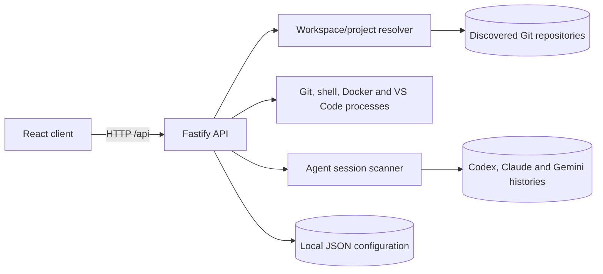

# Architecture

repo-control is a local-first TypeScript application with a Fastify API and a React client. Code is grouped by runtime first, then by domain or responsibility.

## Runtime topology

During development, Vite serves the React app on `127.0.0.1:5173` and proxies `/api` to Fastify on `127.0.0.1:3747`. Both bind to localhost by default.



The browser sends project identifiers, never an arbitrary working directory for a project action. The server decodes the identifier, verifies that the path is inside the active workspace and confirms that it is a discovered Git repository before executing a command there.

Changing the active workspace updates in-memory resolver state. It does not rewrite `.env` or restart the process.

## Server

```text
apps/server/src/
  config/       environment parsing and runtime configuration
  lib/          command execution and project-boundary helpers
  routes/       HTTP schemas, request validation and response mapping
  services/     application use cases and external-tool integrations
    workflow/   workflow schemas, validation, inputs and JSON storage
    tools/      the agent tool catalog: definitions, repository matching and the registry
  docker.ts     Docker discovery plus Compose service, health and port normalization
  folderPicker.ts
                native workspace selection across supported platforms
  gitScanner.ts recursive repository discovery and summary reads
  preferences.ts
                OS-specific configuration-directory ownership
  runtime.ts    shell and VS Code detection
  terminalMemory.ts
                local command suggestions
```

Routes should stay thin: validate input, call a service and translate expected errors to HTTP responses. Services own application behavior. File persistence, normalization and compatibility code belong in a domain subdirectory rather than in the service orchestrator.

Git operations that change a repository live in `services/gitActions.ts`, with the validation schemas for refs, paths, stash references and messages. `gitRoutes` and the planned agent tool layer call the same functions, so the fast-forward-only pull and the dirty-checkout guard cannot diverge between the dashboard and the agent. Guarded actions return `{ status: "blocked", message }` instead of throwing; the route maps it to HTTP 409.

Current route domains are:

| Domain | Responsibility |
| --- | --- |
| `authRoutes` | Sign-in state, sign-in and sign-out when credentials are configured. |
| `appRoutes` | Health, workspace discovery and selection, favorites, updates and VS Code launch. |
| `agentSessionRoutes` | Workspace-scoped agent history search and validated native-terminal resume. |
| `gitRoutes` | Git details, activity, file diffs, staged summaries, staging, commits, stashes, sync and branches. |
| `terminalRoutes` | Scoped shell execution, one active command per repository, cancellation and command suggestions. |
| `dockerRoutes` | Container discovery, resource samples, container shell and log sessions, plus validated Compose service state, logs, restart and stack actions. |
| `workflowRoutes` | Workflow CRUD, dry runs, background runs, progress reads and cancellation. |

### Agent tool layer

`services/tools/` is the catalog of what an agent may do in the workspace. A tool is a plain definition: a name, a description written for a model, a zod input shape (the form the MCP SDK accepts) and an effect, `read` or `write`. `createToolkit` turns the catalog into a callable registry: it validates input strictly, runs the tool and converts expected failures, such as an unknown or ambiguous repository or a refused checkout, into `isError` results the model can read and recover from.

Tools name repositories the way a person does: by name, workspace-relative path or the ID from an earlier result. `matchRepository` turns that into exactly one discovered repository and lists the candidates when it cannot; the resolver then revalidates the chosen ID, so the boundary check stays the authority. Results use workspace-relative paths and truncate long diffs and command output.

Write tools call the same `services/gitActions.ts` functions as the dashboard, so the fast-forward-only pull and the dirty-checkout guard apply to the agent too. There is deliberately no tool for arbitrary shell commands. The MCP server and the in-app agent are consumers of this catalog; approval for `write` tools belongs to them.

The catalog covers four areas:

| Area | Read | Write |
| --- | --- | --- |
| Repositories and Git | `list_repositories` (with a label filter), `get_repository`, `git_log`, `git_diff`, `list_branches` | `git_fetch`, `git_pull`, `git_push`, `git_checkout`, `git_create_branch`, `git_commit` |
| Workspace knowledge | `search_workspace` | none |
| Docker Compose | `list_containers`, `compose_status`, `compose_logs` | `compose_up`, `compose_stop`, `compose_restart_service` |
| Workflows | `list_workflows`, `preview_workflow`, `get_workflow_run` | `run_workflow`, `cancel_workflow_run` |
| Coding-agent sessions | `list_agent_sessions` | none |

Compose tools first check that the repository has a Compose file, and service names must start with a letter or digit, so they never reach `docker compose` as an option. Workflow tools can find, preview, start and follow the workflows saved in the dashboard but not create or edit one: a workflow can contain shell commands, so authoring stays with the user. A preview is a dry run, which only resolves commands and records the preview in the run history.

### Workspace knowledge index

`services/knowledge/` builds a local index of what every repository is about. It powers repository labels, the `search_workspace` agent tool, the label filter of `list_repositories` and `/api/knowledge`.

- **Collect** (`collect.ts`). The index reads files listed by `git ls-files`, so `.gitignore` is respected. From those it takes manifests (npm, Python, Rust, Go, Java, .NET, PHP, Ruby), the README, up to five docs, the names of Compose services and the 40 latest commit subjects. Every read is capped.
- **Label** (`labels.ts`). Rules turn that evidence into labels of five kinds: kind (api, web app, cli, library, monorepo, mobile, documentation…), language, framework, tooling and topic. Each label records its evidence, for example "dependency fastify" or "62% of source files", so it can be explained. Topic labels such as payments, authentication or developer tools are matched by meaning, comparing the summary's embedding with one-sentence topic descriptions. They exist only when an embedding provider is present.
- **Chunk** (`chunk.ts`). Each repository becomes a synthesized summary plus its README and docs split at headings, its manifests and its commit subjects. Every chunk is prefixed with the repository name.
- **Store** (`store.ts`). One SQLite file, `knowledge.sqlite` in the configuration directory, using Node's built-in `node:sqlite`, with a table of chunks and a table of vectors. Rows are scoped by workspace root. A change of embedding model drops the old vectors and marks everything for re-indexing. A file with an older schema is rebuilt, because the index is a cache of the workspace.
- **Rank** (`bm25.ts`). Full-text ranking is BM25 over an in-memory inverted index, built per workspace on the first query and dropped when anything is saved. Words are lower-cased with accents removed, and each query word also matches as a prefix (invoice → invoices). Snippets centre on the first match. SQLite's FTS5 would do the same, but whether it is compiled into `node:sqlite` depends on the Node release (22.13 ships without it). A workspace has a few thousand chunks at most, so the in-memory index is fast and behaves the same on every supported Node.
- **Search** (`search.ts`). Full-text hits and, when available, cosine-similarity hits are merged with reciprocal rank fusion (k = 60). The best three chunks of each repository add up to its score, and a query that names a repository or one of its labels gets a boost.
- **Index** (`index.ts`). Runs four repositories at a time and skips any whose fingerprint (HEAD, file count, manifests, README, docs, Compose services) has not changed. Repositories that left the workspace are pruned. The first search of an empty index builds it.

Semantic search is optional because its runtime, transformers.js with ONNX Runtime, adds several hundred megabytes. `embeddings.ts` defines the provider interface and loads transformers.js only when it is installed in `<config>/extensions`, then embeds locally with `REPO_CONTROL_EMBEDDING_MODEL` (default `Xenova/paraphrase-multilingual-MiniLM-L12-v2`, which handles Italian as well as English). Without it, labels come from rules and search is full-text only. No text leaves the machine in either mode. The index opens lazily, so starting repo-control creates no database until the index is used.

### MCP server

`services/mcp/server.ts` turns the tool catalog into an MCP server with the official TypeScript SDK. It registers one MCP tool per catalog entry, maps the effect and hints to MCP annotations, and leaves write tools out entirely when writes are not allowed. The callback passes input straight to `toolkit.run`, so validation, repository resolution and error handling are the toolkit's.

There are two transports:

- `mcpStdio.ts`, started by `repo-control mcp`, for clients that spawn repo-control themselves. stdout belongs to the protocol, so that path logs to stderr only.
- `routes/mcpRoutes.ts`: `POST /mcp` over Streamable HTTP in stateless mode, with a fresh server and transport per request and JSON responses instead of streams. The route sits outside the `/api` sign-in gate, since MCP clients have no browser session. `services/mcp/access.ts` authorizes each request by bearer token instead, after the global `Host` check has run.

### In-app agent

`services/agent/runner.ts` runs the dashboard's agent as Claude Code in headless mode (`claude -p --output-format stream-json`) and restricts it to repo-control:

- built-in tools are disabled (`--tools ""`) and user and project settings are not loaded (`--setting-sources ""`), so the agent has no shell or file access, and no allow rule in `~/.claude` can pre-approve anything;
- its only MCP server is this process's own `/mcp` (`--strict-mcp-config`), reached with a token issued for that run and revoked when it ends; the token is written to a `0600` config file in a temporary directory, never put on the command line;
- read tools are pre-allowed (`--allowedTools`), and every write tool goes through `--permission-prompt-tool mcp__repo-control__approve`.

The `approve` tool exists only on MCP servers created for an agent token. It turns Claude Code's permission prompt into an `approval_request` event and waits for the dashboard's answer. A deny tells the model not to retry. An unanswered request is denied after 10 minutes, and stopping the run denies whatever is pending. Tool names outside the catalog are refused without asking.

`services/agent/events.ts` reduces stream-json to the events the dashboard renders: session, text deltas, full text blocks, tool calls and results, approvals, the result with cost and turns, errors and status. Each event carries a sequence number. `routes/agentRoutes.ts` starts runs (`POST /api/agent/runs`, which takes `sessionId` to continue a conversation through `--resume`), streams events over server-sent events with replay from `Last-Event-ID`, and accepts approvals and cancellation. Runs live in memory: one at a time, with the last 20 kept for replay.

### Container sessions

`createContainerSessionStore` owns the processes behind the container console. A session is a long-lived `docker` client - `docker exec -i <id> <shell>` or `docker logs --follow <id>` - which the one-shot command runner cannot represent, because that runner resolves only once a process has exited.

Each session keeps its output in a capped buffer with a monotonic character cursor. The client sends the cursor it last saw and receives everything after it, so a slow poll loses nothing that is still inside the window, and a read that starts before the retained window is answered with `truncated: true` rather than a silent gap. stdout and stderr share one buffer, because a terminal interleaves them.

Sessions are capped in number, dropped after an idle period with no reads, and closed on server shutdown; exited sessions keep their transcript readable but release their slot. The store takes an injectable spawner, so its lifecycle is tested against real pipes without a Docker daemon.

Container-scoped routes validate the ID shape and then revalidate it against the running containers, which is the container equivalent of resolving a project ID against discovered repositories: the browser never names a process to run, only a container the daemon already reports.

### Sign-in

`createAuthGuard` owns the optional credential check. It is enabled only when `REPO_CONTROL_AUTH_USERNAME` and `REPO_CONTROL_AUTH_PASSWORD` are both set; with one of the two, `readEnv` rejects the configuration and the server does not start.

When enabled, an `onRequest` hook registered after the `Host` check rejects `/api` requests without a valid session cookie, so an unauthenticated caller never reaches project resolution or command execution. `/api/auth/*` and `/api/health` stay reachable - the dashboard has to ask whether a sign-in is required, and a supervisor has to be able to probe the API - and the health route withholds the workspace root until the caller is authenticated. Non-`/api` paths are never gated: the dashboard bundle has to load for the sign-in screen to exist.

Sessions are opaque tokens stored as digests in process memory with an expiry, sent as an `HttpOnly`, `SameSite=Strict` cookie. Nothing is persisted, so a restart ends every session. Credential comparison is constant-time and repeated failures pause sign-in briefly.

### Project boundary

`createProjectResolver` owns the active root and project resolution. Project IDs are base64url-encoded paths relative to that root. Resolution rejects traversal, paths outside the root and directories that are not Git repositories.

Keep this boundary in server code. New browser APIs should accept a project ID and derive the working directory through the resolver; they should not accept a client-provided absolute path.

### Agent sessions

Agent discovery reads the tools' existing local files concurrently:

- Codex JSONL sessions under `CODEX_HOME` or `~/.codex`;
- Claude Code project transcripts under `CLAUDE_CONFIG_DIR` or `~/.claude`;
- Gemini CLI chats under `~/.gemini`.

Candidates are associated with the most specific discovered repository containing their recorded working directory. Search is performed server-side over titles and transcript messages. Resume requests are revalidated against both the session scan and the project resolver before a detached native terminal is opened.

### Workflow execution

Workflow definitions are validated as a connected, directed graph before preview or execution. Text inputs are resolved into execution-scoped environment variables. A real run is persisted as `pending` and returned with HTTP 202; the client polls its run ID while the server executes steps in the background.

Only one active run is allowed per workflow. Cancellation propagates an `AbortSignal` to running commands. On startup, persisted `pending` or `running` records are marked `interrupted` because their in-memory controllers cannot be recovered.

Failure is tracked per repository, not per run: a repository whose step fails is skipped by the steps that follow, while the others carry on. The summary node is never skipped, because the run that failed is the one whose outcome has to be readable. Each node decides per repository whether it can act at all and returns the reason next to the guard that produced it, so a skip message cannot drift from the condition behind it.

## Web

```text
apps/web/src/
  api/          API clients split by domain; http.ts owns shared transport behavior
  components/   UI grouped by feature
    agents/     unified local agent history
    auth/       sign-in screen, shared session read and sidebar profile menu
    automation/ visual workflow editor, execution and history
    dashboard/  navigation, the widget home (`widgets/`, `dashboardLayout.ts`) and repository discovery
    docker/     container console sessions and resource-usage formatting
    project/    capability-driven overview, Git diff, branch, terminal and Docker panels
    settings/   local interface preferences: language, palette and text size
    shared/     reusable presentation components with no feature ownership
  types/        API and UI contracts split by domain
  utils/        pure cross-feature helpers
```

Feature components import their own API module and domain types directly. Avoid adding a global API client or type barrel: explicit imports keep dependencies visible and prevent unrelated features from becoming coupled.

Large pages should orchestrate data and navigation. Extract independent panels, dialogs and pure domain logic once they have their own state, props or testable behavior.

Repository details use a single full-width shell: Overview is the default and feature tabs are rendered only when their repository capability exists. Docker currently follows this rule through Compose-file detection. Deploy is intentionally absent; any future CI/CD tab must be backed by detected pipeline configuration and real status/actions rather than a static placeholder. Once opened, the terminal panel remains mounted while the repository workspace stays open so its transcript and active request survive navigation between repository tabs.

The application shell reads the sign-in state once and chooses between the sign-in screen and the dashboard from it. A request that any feature makes and the API answers with `401 UNAUTHENTICATED` updates that same cached state through the shared query cache, so a lapsed session returns to the sign-in screen instead of leaving a page of failed panels behind. An unreadable sign-in state falls through to the dashboard on purpose: the API enforces the gate, and a local tool should not lock its owner out because one request failed.

Dashboard sections are lazy-loaded.

Interface preferences are owned by the application shell rather than by the screen that presents them: `App.tsx` holds the palette and text size, writes them to `localStorage` and passes them down, so the theme is rebuilt in one place. Both are offered twice on purpose - as a quick switch in the sidebar profile menu and as a described choice in the settings section - and the profile menu is the only sign-out entry point. It renders whether or not credentials are configured, because a workspace with no session still has preferences to reach.

Text size is applied through the theme's `unstable_sxConfig` transform for `fontSize`, not by editing components. Most type sizes here are written inline as `sx={{ fontSize: 10.5 }}`, so scaling `typography` alone would grow the headings and leave the small mono labels untouched; the transform reaches every inline number, the themed sizes and the icon sizes from one definition. A new inline size therefore scales automatically, and a size that must stay fixed is written as a CSS string.

Static files in `apps/web/public/` are copied to the served root by the build, so they answer before the single-page fallback. That ordering matters for machine-readable files such as `llms.txt`: the fallback returns `index.html` for any unmatched GET, so a missing file at a well-known path answers 200 with the application shell rather than 404.

## Persistence

`getConfigDirectory()` provides the single root for repo-control-owned server data. `REPO_CONTROL_CONFIG_DIR` overrides the OS default.

| Path below the config directory | Contents |
| --- | --- |
| `preferences.json` | Favorite project IDs, the most recently opened repositories and the dashboard widget layout. `PUT /api/preferences` merges a partial document over the stored one, so each caller sends only the key it owns. |
| `terminal-history.json` | Normalized terminal commands, repository paths, counts and last-used times; capped at 500 entries. |
| `workflows.json` | Visual workflow definitions. |
| `workflow-runs.json` | The latest 100 dry runs and real runs, including step commands and output. |

Agent transcripts remain in their provider-owned directories and are not copied here. Palette, text size and language are browser `localStorage`, not server JSON.

Writes that can race use temporary files plus rename. Workflow definition and run-history mutations also have separate in-process queues to prevent lost updates.

## Dependency direction

- Web components may depend on `api`, `types` and `utils`.
- API modules may depend on `api/http.ts` and domain types, never on components.
- Server routes may depend on services and `lib` contracts.
- Services may depend on domain helpers and infrastructure, never on routes.
- Domain normalization and persistence modules should not import HTTP or UI code.
- Platform detection belongs in server runtime services, not React components.

## Quality gates

Run the following before sharing a change:

```bash
npm run verify
npm run test:e2e
```

`verify` runs ESLint, React Hooks validation, the strict TypeScript compiler, server and React test suites with 80% global coverage thresholds, and the production web build. `test:e2e` starts the real local server and dashboard, then verifies critical user flows in Chromium.

The GitHub Actions matrix runs `verify` on Node.js 22.13 and 24. Browser E2E runs on Node.js 24 after the matrix succeeds.
